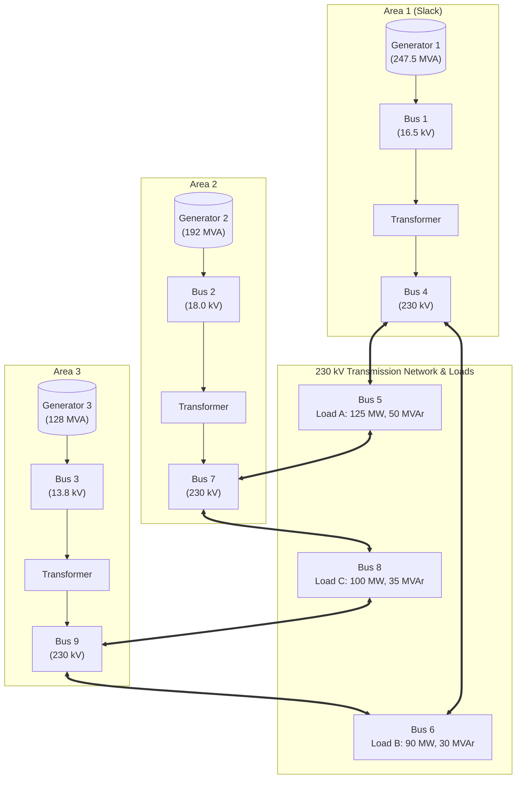

# WSCC 9-Bus Power System Simulation: Transient Stability & Load Frequency Control (LFC)

A comprehensive MATLAB & Simulink modeling suite for the standard **WSCC 3-Machine 9-Bus System** (Western System Coordinating Council). This repository provides complete dynamic simulations for two fundamental power system phenomena:

1. **Multi-Machine Transient Stability**: Classical generator model under a severe 3-phase fault at Bus 7 with line 5–7 tripping, solved using dynamic Kron-reduced admittance matrices.
2. **Primary Load Frequency Control (LFC) & Governor Dynamics**: Detailed frequency response, RoCoF analysis, speed governor & turbine dynamics, and inter-machine oscillation damping under sudden load disturbances.

---

## Table of Contents
- [System Architecture & Overview](#system-architecture--overview)
- [System Parameters & Base Data](#system-parameters--base-data)
- [Mathematical Formulations](#mathematical-formulations)
  - [1. Classical Multi-Machine Swing Equations](#1-classical-multi-machine-swing-equations)
  - [2. Kron Network Reduction](#2-kron-network-reduction)
  - [3. Speed Governor & Turbine Dynamics](#3-speed-governor--turbine-dynamics)
  - [4. Analytical Steady-State Frequency Prediction](#4-analytical-steady-state-frequency-prediction)
- [Repository Structure](#repository-structure)
- [Simulation Models & Usage](#simulation-models--usage)
  - [A. Load Frequency Control (LFC) Study](#a-load-frequency-control-lfc-study)
  - [B. Transient Stability Study](#b-transient-stability-study)
- [Simulation Results & Visualizations](#simulation-results--visualizations)
  - [System Overview & Key Metrics](#system-overview--key-metrics)
  - [Frequency Response & RoCoF](#frequency-response--rocof)
  - [Active Power Allocation (Mechanical vs. Electrical)](#active-power-allocation-mechanical-vs-electrical)
  - [Relative Rotor Angles](#relative-rotor-angles)
- [Requirements & Setup](#requirements--setup)

---

## System Architecture & Overview

The WSCC 9-bus test network represents a widely referenced benchmark for power system stability and dynamic performance studies:



- **Nominal System Frequency:** $f_0 = 60\text{ Hz}$ ($\omega_s = 2\pi f_0 = 376.99\text{ rad/s}$)
- **System Power Base:** $S_{\text{base}} = 100\text{ MVA}$

---

## System Parameters & Base Data

### 1. Synchronous Generator Specifications
All inertia values $H$ are referenced to the common system base ($100\text{ MVA}$).

| Parameter | Generator 1 (SG1) | Generator 2 (SG2) | Generator 3 (SG3) | Unit |
| :--- | :---: | :---: | :---: | :---: |
| **Bus Location** | Bus 1 (Slack) | Bus 2 (PV) | Bus 3 (PV) | — |
| **Machine Rating ($S_{\text{MVA}}$)** | 247.5 | 192.0 | 128.0 | $\text{MVA}$ |
| **Rated Voltage** | 16.5 | 18.0 | 13.8 | $\text{kV}$ |
| **Terminal Voltage ($V_t$)** | $1.040 \angle 0.0^\circ$ | $1.025 \angle 9.3^\circ$ | $1.026 \angle 4.7^\circ$ | $\text{pu}$ |
| **Active Power ($P_g$)** | 71.6 | 163.0 | 85.0 | $\text{MW}$ |
| **Reactive Power ($Q_g$)** | 27.0 | 6.7 | -10.9 | $\text{MVAr}$ |
| **Transient Reactance ($X_d'$)** | 0.0608 | 0.1198 | 0.1813 | $\text{pu}$ |
| **Inertia Constant ($H_{100}$)** | 23.645 | 6.400 | 3.010 | $\text{s}$ |
| **Speed Droop ($R$)** | 0.05 | 0.05 | 0.05 | $\text{pu (own base)}$ |
| **Governor Time Const. ($T_g$)** | 0.20 | 0.20 | 0.20 | $\text{s}$ |
| **Turbine Time Const. ($T_t$)** | 0.50 | 0.50 | 0.50 | $\text{s}$ |
| **Damping Coefficient ($D$)** | 4.0 | 4.0 | 4.0 | $\text{pu (own base)}$ |

### 2. Transmission Line & Transformer Parameters ($100\text{ MVA}$ base)

| Line / Element | From Bus | To Bus | Resistance $R$ [pu] | Reactance $X$ [pu] | Total Charging $B$ [pu] |
| :---: | :---: | :---: | :---: | :---: | :---: |
| Transformer 1 | 1 | 4 | 0.0000 | 0.1184 | 0.0000 |
| Line 4–6 | 4 | 6 | 0.0170 | 0.0920 | 0.1580 |
| Line 4–5 | 4 | 5 | 0.0100 | 0.0850 | 0.1760 |
| Line 6–9 | 6 | 9 | 0.0390 | 0.1700 | 0.3580 |
| Line 5–7 | 5 | 7 | 0.0320 | 0.1610 | 0.3060 |
| Transformer 2 | 7 | 2 | 0.0000 | 0.1823 | 0.0000 |
| Line 7–8 | 7 | 8 | 0.0085 | 0.0720 | 0.1490 |
| Line 8–9 | 8 | 9 | 0.0119 | 0.1008 | 0.2090 |
| Transformer 3 | 9 | 3 | 0.0000 | 0.2399 | 0.0000 |

---

## Mathematical Formulations

### 1. Classical Multi-Machine Swing Equations
Each synchronous generator is modeled as a constant voltage magnitude behind transient reactance ($E_i' \angle \delta_i$):

$$\frac{d\delta_i}{dt} = \Delta \omega_i = \omega_i - \omega_s$$

$$\frac{2 H_i}{\omega_s} \frac{d\Delta \omega_i}{dt} = P_{m,i} - P_{e,i} - D_i k_{S,i} \frac{\Delta \omega_i}{\omega_s}$$

$$\text{RoCoF}_i \ [\text{Hz/s}] = \frac{f_0}{2 H_i} \left( \frac{P_{m,i} - P_{e,i}}{S_{\text{base}}} - D_i k_{S,i} \frac{\Delta \omega_i}{\omega_s} \right)$$

where:
- $k_{S,i} = S_{\text{MVA},i} / S_{\text{base}}$ converts machine-base damping and capacity to the common base.
- $P_{e,i} = \text{Re} \left\{ E_i \sum_{j=1}^{n} Y_{\text{red},ij}^* E_j^* \right\}$ is the electrical power delivered to the network.

### 2. Kron Network Reduction
All passive network nodes (buses 4 through 9) and loads (represented as equivalent shunt admittances $Y_L = \frac{P_L - j Q_L}{|V|^2}$) are eliminated via Kron reduction, retaining only the internal generator nodes $1..3$:

$$Y_{\text{red}} = Y_{GG} - Y_{GL} \, Y_{LL}^{-1} \, Y_{LG}$$

- **Pre-Fault ($Y_1$):** Normal intact network topology.
- **Fault ($Y_2$):** 3-phase short-circuit applied at Bus 7 (Bus 7 row and column removed).
- **Post-Fault ($Y_3$):** Fault cleared by opening line 5–7.
- **Load Step ($Y_{\text{step}}$):** Conductance $\Delta G_L = \frac{\Delta P_L / S_{\text{base}}}{V_{\text{load}}^2}$ added at the disturbance bus.

### 3. Speed Governor & Turbine Dynamics
Primary frequency regulation uses standard non-reheat steam/hydro speed-droop governors:

$$\Delta P_{m,i}(s) = -\frac{1}{R_i} \cdot \left(\frac{\Delta \omega_i}{\omega_s}\right) \cdot \frac{1}{1 + s T_{g,i}} \cdot \frac{1}{1 + s T_{t,i}} \cdot S_{\text{MVA},i}$$

### 4. Analytical Steady-State Frequency Prediction
Under primary droop and generator damping, the total system frequency response stiffness $\beta$ is:

$$\beta = \sum_{i=1}^3 k_{S,i} \left( \frac{1}{R_i} + D_i \right) \quad [\text{pu}_{\text{MW}} / \text{pu}_{\text{Hz}}]$$

$$\Delta f_{\text{ss}} = -\frac{\Delta P_L / S_{\text{base}}}{\beta} \cdot f_0 \quad [\text{Hz}]$$

$$f_{\text{ss}} = f_0 + \Delta f_{\text{ss}}$$

---

## Repository Structure

```
├── figures/                                    # Generated simulation graphics
│   ├── wscc9_lfc_frequency_dP+20MW_bus5_t1s.png      # Generator frequencies & RoCoF
│   ├── wscc9_lfc_overview_dP+20MW_bus5_t1s.png       # Consolidated multi-panel overview
│   ├── wscc9_lfc_power_dP+20MW_bus5_t1s.png           # Mechanical vs. electrical powers
│   └── wscc9_lfc_rotor_angles_dP+20MW_bus5_t1s.png    # Inter-machine rotor angles
├── wscc9_lfc_governor.slx                      # Simulink model for LFC & primary control
├── wscc9_lfc_init.m                            # Initialization script for LFC study
├── wscc9_lfc_plot.m                            # Post-processing, statistics & figure exporter
├── wscc9_transient_stability.slx               # Simulink model for multi-machine fault study
├── wscc9_transient_init.m                      # Admittance matrix & fault conditions initialization
└── README.md                                   # Project documentation
```

---

## Simulation Models & Usage

### A. Load Frequency Control (LFC) Study

#### 1. Configure the Disturbance
Edit the parameters at the top of [`wscc9_lfc_init.m`](./wscc9_lfc_init.m):
```matlab
dP_L_MW  = 20;     % Active load disturbance in MW (+ for load increase, - for rejection)
step_bus = 5;      % Load bus location (5, 6, or 8)
t_step   = 1.0;    % Time of load step [s]
R        = 0.05;   % Governor droop (5%)
Tg       = 0.2;    % Governor time constant [s]
Tt       = 0.5;    % Turbine time constant [s]
D        = 4.0;    % Generator damping coefficient
```

#### 2. Run and Visualize
Run [`wscc9_lfc_plot.m`](./wscc9_lfc_plot.m) directly in MATLAB:
```matlab
>> wscc9_lfc_plot
```
This automatically:
- Executes `wscc9_lfc_governor.slx`.
- Computes analytical metrics: Frequency nadir, time-to-nadir, maximum RoCoF, 5% settling time, and final steady-state frequency.
- Displays a formatted performance summary table in the Command Window.
- Exports publication-ready high-resolution figures to the `figures/` directory.

### B. Transient Stability Study

1. Run [`wscc9_transient_init.m`](./wscc9_transient_init.m) to formulate pre-fault ($Y_1$), during-fault ($Y_2$), and post-fault ($Y_3$) reduced admittance matrices and generator initial internal voltages ($E_i$) and angles ($\delta_{i0}$).
2. Open and run [`wscc9_transient_stability.slx`](./wscc9_transient_stability.slx) to observe critical clearing time (CCT) and multi-machine swing curves.

---

## Simulation Results & Visualizations

The following results illustrate a $+20\text{ MW}$ sudden load increase at Bus 5 at $t = 1.0\text{ s}$.

### System Overview & Key Metrics
Consolidated dynamic response showing individual generator speeds, RoCoF, mechanical vs. electrical powers, rotor angle deviations, and numerical summary:


### Frequency Response & RoCoF
Tracking transient frequency deviations, inertial response slope, frequency nadir, and subsequent governor recovery:


### Active Power Allocation (Mechanical vs. Electrical)
Demonstration of primary droop sharing across generators proportional to their ratings ($S_{\text{MVA}}$):


### Relative Rotor Angles
Inter-machine oscillations between SG2, SG3, and SG1:


### Summary Performance Table ($+20\text{ MW}$ at Bus 5)

| Generator | Rating ($S_{\text{MVA}}$) | Nadir ($f_{\text{min}}$) [Hz] | Time to Nadir ($t_{\text{nadir}}$) [s] | Max RoCoF [Hz/s] | Settling Time ($t_{\text{set}}$) [s] | Droop Share $\Delta P_m$ [MW] |
| :--- | :---: | :---: | :---: | :---: | :---: | :---: |
| **SG1** | 247.5 MVA | 59.8821 | 3.05 | -0.063 | 12.8 | 8.65 |
| **SG2** | 192.0 MVA | 59.8824 | 2.92 | -0.231 | 12.9 | 6.71 |
| **SG3** | 128.0 MVA | 59.8785 | 2.80 | -0.490 | 12.7 | 4.47 |
| **Total** | 567.5 MVA | — | — | — | — | **19.83 MW** |

- **Nominal Predicted Steady-State Frequency:** $59.8837\text{ Hz}$ ($\Delta f = -0.1163\text{ Hz}$)
- **Simulated Final Frequency:** $59.8851\text{ Hz}$ (accounts for network losses and voltage-dependent load characteristics)

---

## Requirements & Setup

- **MATLAB & Simulink:** R2020b or later (compatible with current releases).
- **Toolboxes:**
  - Simulink
  - Control System Toolbox (recommended for linear analysis)
  - Optimization / Signal Processing Toolbox (optional)
- **Execution:** No compilation or external C-mex S-functions required; uses native Simulink blocks and vectorised MATLAB functions.

---

## References
1. Anderson, P. M., & Fouad, A. A. (2003). *Power System Control and Stability*. Wiley-IEEE Press.
2. Saadat, H. (2010). *Power System Analysis*. McGraw-Hill.
3. Western System Coordinating Council (WSCC) 9-Bus Test Case data.
